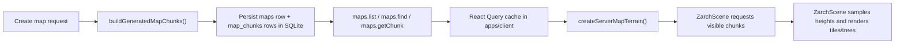

# Map Architecture

This note describes how the gameplay map works today across the shared contracts, the API server, and the gameplay client in `apps/client`.

The focus is the Zarch gameplay path, not the admin map viewer. It explains:

- how map data is shaped
- how the API generates and stores it
- how the client fetches it
- how the client turns fetched chunks into terrain queries
- how `ZarchScene` renders the terrain each frame

## Shared Map Model

The shared map contract lives in `packages/contracts/src/schema/maps/index.ts`.

The core public types are:

- `MapMetadata`: one record per map, including identity, generator, dimensions, and unit conversion metadata
- `MapChunk`: one terrain chunk, including its chunk coordinates, tile origin, tile dimensions, sample dimensions, and height samples

Important constants from the shared schema:

- `MAP_CHUNK_SIZE_TILES = 32`
- `MAP_METERS_PER_TILE = 10`
- `MAP_RENDER_UNITS_PER_TILE = 24`

Those constants describe three different concerns:

- chunking: the world is partitioned into 32x32 tile chunks by default
- simulation/world scale: each tile represents 10 metres in map metadata
- client render scale: each tile is rendered at 24 client units

`MapMetadata` carries both the tile dimensions and the derived metre dimensions:

- `widthTiles`, `heightTiles`
- `metersPerTile`
- `widthMeters`, `heightMeters`
- `renderUnitsPerTile`
- `chunkSizeTiles`
- `generator`, `seed`, timestamps, and user-facing `name`

`MapChunk` carries the terrain payload needed to reconstruct a local heightfield window:

- `chunkX`, `chunkZ`
- `originTileX`, `originTileZ`
- `tileWidth`, `tileHeight`
- `samplesWide`, `samplesHigh`
- `heights`
- `layers.height`, which currently declares `float32` metre heights

The important detail is that chunks store raw height samples, not render-ready output. They do not contain:

- precomputed tile colors
- mesh data
- tree placements
- minimap bitmaps
- gameplay scene objects

Those are derived later by the client.

## Server Generation And Storage

The API-side map repository lives in `apps/api/src/maps/repository.ts`, and generation logic lives in `apps/api/src/maps/generation.ts`.

### Creation Flow

`MapRepository.createMap()` does all map generation up front.

1. It builds a new `MapMetadata`-like row using shared defaults from `getDefaultMapConfig()`.
2. It chooses the generator from the request input.
3. It generates the full heightfield and splits it into chunks with `buildGeneratedMapChunks(...)`.
4. It writes the map row and all chunk rows inside a SQLite transaction.

There are currently two generators:

- `diamond-square`
- `island-clusters`

Both are deterministic for a given `(generator, seed, widthTiles, heightTiles)` input. That determinism is relied on by the tests in `apps/api/src/maps/generation.test.ts`.

### Heightfield Generation

`buildGeneratedMapChunks(...)` generates one full heightfield first, then slices it into chunk records.

The generated heightfield uses sample grids, not tile-center values:

- a map that is `widthTiles x heightTiles` produces `(widthTiles + 1) x (heightTiles + 1)` height samples
- each chunk follows the same pattern, so a 32x32 tile chunk normally has 33x33 corner samples
- edge chunks can be smaller in tile size, and their sample dimensions shrink accordingly

That sample layout is what lets adjacent chunks share border samples exactly. The generation tests explicitly verify seam continuity between neighboring chunks.

### SQLite Storage Model

The repository creates two tables during migration:

```sql
CREATE TABLE IF NOT EXISTS maps (
  id TEXT PRIMARY KEY,
  name TEXT,
  width_tiles INTEGER NOT NULL,
  height_tiles INTEGER NOT NULL,
  meters_per_tile INTEGER NOT NULL,
  render_units_per_tile INTEGER NOT NULL,
  chunk_size_tiles INTEGER NOT NULL,
  generator TEXT NOT NULL,
  seed TEXT NOT NULL,
  created_at TEXT NOT NULL,
  updated_at TEXT NOT NULL
);

CREATE TABLE IF NOT EXISTS map_chunks (
  map_id TEXT NOT NULL,
  chunk_x INTEGER NOT NULL,
  chunk_z INTEGER NOT NULL,
  origin_tile_x INTEGER NOT NULL,
  origin_tile_z INTEGER NOT NULL,
  tile_width INTEGER NOT NULL,
  tile_height INTEGER NOT NULL,
  samples_wide INTEGER NOT NULL,
  samples_high INTEGER NOT NULL,
  heights BLOB NOT NULL,
  PRIMARY KEY (map_id, chunk_x, chunk_z),
  FOREIGN KEY (map_id) REFERENCES maps(id) ON DELETE CASCADE
);
```

The storage split is straightforward:

- `maps` stores map-level metadata
- `map_chunks` stores per-chunk terrain samples and chunk geometry metadata

The `heights` column is persisted as a float32-encoded BLOB:

- generation produces `Float32Array`
- `encodeFloat32Heights(...)` copies that float32 buffer into `Uint8Array`
- SQLite stores the bytes in `map_chunks.heights`
- `decodeFloat32Heights(...)` reconstructs a `Float32Array` when reading
- `toMapChunkResponse(...)` converts the typed array to a plain `number[]` for the API response and attaches the `layers.height` descriptor

The server persists terrain data and metadata only. It does not persist client-side render decoration such as:

- tile tinting
- water shading
- tree presence
- tree type
- mesh pool state

## Server Fetch Surface

The maps API routes live in `apps/api/src/orpc/router/maps/index.ts`. They are declared from the shared contract and exposed through the ORPC/OpenAPI server mounted at `/api/*` in `apps/api/src/index.ts`.

The gameplay client uses three map routes:

- `maps.list`: returns available `MapMetadata[]`
- `maps.find`: returns one `MapMetadata` by `id`
- `maps.getChunk`: returns one `MapChunk` by `(mapId, chunkX, chunkZ)`

At runtime, the server path is:

1. Elysia receives the request under `/api/*`
2. `OpenAPIHandler` dispatches to the ORPC router
3. the maps route handler calls `getMapRepository()`
4. the repository reads SQLite and returns contract-shaped data

On the client side, `apps/client/src/helpers/api-link.ts` creates an ORPC OpenAPI client pointed at the configured API base URL. The gameplay client calls that generated client rather than building URLs by hand.

## Client Loading Flow

The gameplay client map bootstrap lives in `apps/client/src/screens/zarch/use-server-map-terrain.ts`.

### Map Selection

The hook resolves the active map in two steps:

1. call `client.maps.list({})`
2. choose the target map

The selection logic is:

- if the URL contains `?mapId=...`, use that map ID and fetch metadata with `maps.find`
- otherwise, fall back to the first map returned by `maps.list`

This means metadata fetches are split into two cases:

- list-only path for the default fallback map
- explicit metadata fetch for a requested map ID

### Chunk Fetching And Cache Keys

Once the active map is known, the hook constructs a terrain adapter with `createServerMapTerrain(...)` from `apps/client/src/helpers/zarch-map-terrain.ts`.

That helper defines the React Query keys used by the gameplay client:

- `['maps']`
- `['map', mapId]`
- `['map-chunk', mapId, chunkX, chunkZ]`

Chunk data is fetched lazily. The client does not load the full world before rendering.

### Visible-Window Prefetch

`ZarchScene` calls `terrain.requestVisibleChunks(centerTileX, centerTileZ, viewRadiusTiles)` every frame with the current camera tile and view radius.

`requestVisibleChunks(...)` computes a visible chunk window, then expands it by one extra chunk ring in each direction where possible. That gives the renderer a prefetch buffer around the current view.

For each chunk coordinate in that expanded window, the terrain adapter calls the prefetch function supplied by `useServerMapTerrain()`. React Query handles:

- in-flight deduplication
- cache reuse
- background prefetching

### Terrain Reads Come From Cache

The terrain adapter does not hold its own authoritative map store. Instead, it samples the React Query cache on demand.

`createServerMapTerrain(...)` uses `queryClient.getQueryData(...)` to find cached chunks, then reads the relevant local sample from the chunk's `heights` array.

If the required chunk is not cached yet:

- `sampleHeight(...)` returns `null`
- tile-average sampling can return `null`
- `isTileLoaded(...)` returns `false`

That is the key client-side distinction between:

- metadata fetch: map-level information needed to create the terrain adapter
- chunk fetch: terrain samples needed for actual rendering and terrain queries

## Client Terrain Semantics

`createServerMapTerrain(...)` produces the `ZarchTerrain` abstraction consumed by the gameplay UI and renderer.

It exposes:

- `containsTile(...)`
- `sampleHeight(...)`
- `getTileAverageHeight(...)`
- `isTileLoaded(...)`
- `isWaterTile(...)`
- `requestVisibleChunks(...)`
- `tileColor(...)`
- `shouldHaveTree(...)`
- `treeType(...)`
- map size and chunk size fields

### Height Sampling

Height queries are corner-sample based:

- `sampleHeight(gx, gz)` reads one sample point from the appropriate chunk
- `getTileAverageHeight(gx, gz)` averages the four corner samples of a tile

This mirrors how the chunk data was generated on the server and preserves cross-chunk seams as long as both neighboring chunks are loaded.

### Water Detection

Water is not a stored terrain layer. It is derived in the client from elevation.

`isWaterTile(...)` computes the average of the four tile corner samples and compares it against `WATER_LEVEL`, which is currently `-10`.

As a result:

- server chunk payloads store only heights
- the client infers whether a tile counts as water

### Tree Placement And Tile Color

Trees are also not stored on the server.

The gameplay client derives them procedurally from tile coordinates using helpers in `apps/client/src/helpers/zarch-terrain.ts`:

- `tileHash(...)`
- `shouldHaveTree(...)`
- `getTreeType(...)`

That means tree placement is:

- deterministic for a tile coordinate
- independent of the server chunk payload
- derived after chunk data is loaded

Tile color is also computed client-side with `applyTileColor(...)`, which uses elevation bands plus small coordinate-based variation. The color calculation is a rendering convention, not persisted map data.

## Client Rendering

The gameplay entrypoint is `apps/client/src/screens/main.tsx`.

`Main` is responsible for:

- connecting to the API
- loading the active map and terrain adapter
- initializing the runtime camera state when the map changes
- mounting the React Three Fiber `Canvas`
- rendering `ZarchScene`, `ZarchHud`, and `ZarchMinimap`

The current gameplay renderer uses `TILE = 24`, which matches the stored `renderUnitsPerTile` metadata. In practice, the scene code is still coupled to that constant rather than reading `renderUnitsPerTile` dynamically from `MapMetadata`.

### Scene Pooling

`apps/client/src/screens/zarch/zarch-scene.tsx` keeps fixed mesh pools for the visible world:

- a tile mesh pool sized for the maximum visible tile window
- a tree mesh pool sized for the maximum visible tree count

The scene does not allocate new tile or tree meshes every frame. Instead, it reuses pooled objects and toggles visibility when entries fall outside the current view.

### Per-Frame Terrain Sampling

Each frame, `ZarchScene`:

1. updates camera movement and zoom from runtime/input state
2. converts camera position into map tile coordinates
3. requests the visible chunk window from the terrain adapter
4. iterates over visible tile coordinates around the camera
5. samples four corner heights for each tile:
   - `(gx, gz)`
   - `(gx + 1, gz)`
   - `(gx, gz + 1)`
   - `(gx + 1, gz + 1)`
6. skips tiles whose required samples are not loaded yet
7. writes the tile quad vertices directly into the pooled mesh geometry

This is why unloaded chunks simply disappear from the rendered terrain until their samples arrive.

### Water And Coastline Handling

The scene uses the sampled tile heights in two ways:

- it computes the tile's average elevation for color and lighting
- it checks nearby water occupancy to decide whether tile corners should be flattened

If the current tile or adjacent water checks indicate shoreline/water influence, the affected rendered corner height is replaced with `SEA_Y` instead of the sampled terrain height.

Today:

- `WATER_LEVEL = -10` is the logical water threshold used for tile classification
- `SEA_Y = -12` is the render-time flattened water surface height used by `ZarchScene`

That is a rendering convention layered on top of the stored heightfield.

### Tile Color And Brightness

For each visible tile, the scene:

- asks `terrain.tileColor(...)` for the base terrain color
- computes distance from the camera to the tile center
- applies distance-based darkening to that base color

This shading is also entirely client-side. The server never stores terrain color output.

### Tree Rendering

Tree rendering is gated by both terrain classification and chunk readiness.

A tree is rendered only when all of the following are true:

- the tile is not water
- the tile is not touching shoreline water corners
- the tile is considered loaded
- `terrain.shouldHaveTree(...)` returns `true`

If a tree is placed, `terrain.treeType(...)` chooses between the two pooled tree variants. Tree position is centered on the tile and vertically placed from the averaged corner height.

### Camera And Clip Planes

`ZarchScene` also configures:

- the perspective camera
- four clip planes that crop the visible world around the camera
- ambient and directional lighting
- shadow settings

The camera moves independently from the terrain data, but its tile position drives chunk prefetching and tile iteration.

### HUD And Minimap

`ZarchHud` and `ZarchMinimap` are secondary consumers of the same runtime and terrain state.

- `ZarchHud` reads the camera-centered tile and sampled height for display
- `ZarchMinimap` samples terrain averages to build a simplified 2D map preview

They do not own the map pipeline, but they rely on the same `ZarchTerrain` abstraction and the same chunk-backed terrain queries as the main scene.

## Sequence



## What Is Persisted vs Derived

Persisted on the server:

- map metadata
- chunk dimensions and origin
- raw height samples
- generator choice and seed

Derived on the client:

- water classification
- rendered sea surface flattening
- tile colors and brightness
- tree placement and tree type
- mesh geometry updates
- minimap pixels

That separation is the main architectural boundary in the current implementation: the server owns the heightfield and metadata, while the gameplay client owns most of the final visual interpretation.
